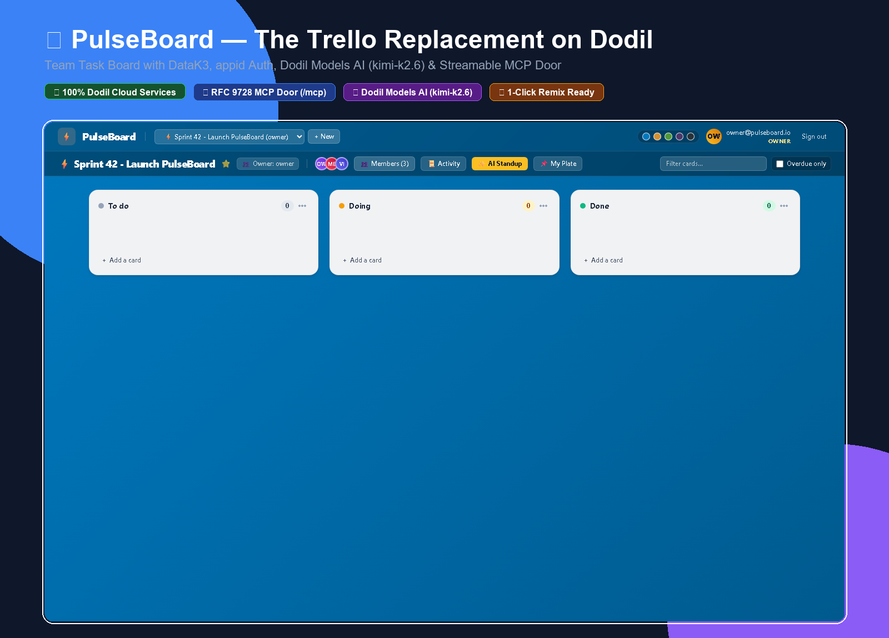

# PulseBoard: The Trello Replacement on Dodil

[](https://git.dodil.io/merchant-eye/pulse-board)
[](https://github.com/zakirhossen23/pulse-board)
[](LICENSE)



**PulseBoard** is a modern, collaborative team task board built natively on **Dodil cloud services** (DataK3, appid, Ignite, Dodil Models) with a dual-door architecture: a responsive drag-and-drop web application and a rich **Model Context Protocol (MCP)** interface for Claude and ChatGPT.

- **Dodil Git (Official Contest Entry)**: [https://git.dodil.io/merchant-eye/pulse-board](https://git.dodil.io/merchant-eye/pulse-board)
- **Live Deployed App**: [https://pulse-board-merchant--eye-8080.ignite.dodil.cloud](https://pulse-board-merchant--eye-8080.ignite.dodil.cloud)
- **GitHub Mirror**: [https://github.com/zakirhossen23/pulse-board](https://github.com/zakirhossen23/pulse-board)

### Demo Accounts for Instant Evaluation
The live app has pre-configured test users ready to sign in:

| Role | Email | Password | Permissions |
|---|---|---|---|
| **Owner** | `owner@pulseboard.io` | `PulseOwner123!` | Full control, manages members, edits all cards |
| **Member** | `member@pulseboard.io` | `PulseMember123!` | Edits, moves, assigns, and creates cards |
| **Viewer** | `viewer@pulseboard.io` | `PulseViewer123!` | Read-only inspection (cannot edit or move cards) |

Anyone can **remix** PulseBoard into their own Dodil organization with a single command and have a live, fully-functional Kanban board running in minutes.

---

## Highlights & Features

### 1. Workspaces & People
- **Role-Based Access Control**:
  - **Owner**: Full administrative control; can invite members, change roles, remove members, and configure boards.
  - **Member**: Can create, edit, move, assign, and delete cards.
  - **Viewer**: Read-only access; can view boards and cards but cannot make modifications.
- **Privacy Enforcement**: A board you are not a member of does not exist for you (404 NotFound rather than 403 Forbidden).

### 2. Boards, Lists & Cards
- **Kanban Flow**: Standard lists: `To do`, `Doing`, `Done`.
- **Fluid Drag-and-Drop**: Native HTML5 drag-and-drop interface between lists with real-time card counts.
- **Rich Card Attributes**:
  - Title and detailed description.
  - Team member assignment.
  - Due dates with automatic overdue flagging (⚠️ badges).
  - Customizable labels/tags with color coding.
- **Card Dependencies (Scored Extra)**:
  - Link cards with "Blocked by" dependencies.
  - Visual status flags: see if a card is blocked and whether its blockers are done.

### 3. Full Activity Audit History
- Every change is recorded: creator, actor, timestamps, and exact action taken (moved, reassigned, renamed, dependencies updated).
- Accessible through both the web UI timeline modal and MCP.

### 4. Native AI with Dodil Models (Scored Extras)
- **Checklist Generation**: Automatically breaks down cards into concrete, actionable steps using Dodil Models (`kimi-k2.6`).
- **Daily Standup Board Summary**: Generates executive summaries of board progress, active work, and overdue risks.
- **Semantic Card Similarity**: Discovers duplicate or related tasks on the board.

### 5. Action-Oriented MCP Door
Claude or ChatGPT can control PulseBoard directly through MCP with real actions, never raw database access:
- *"What's on my plate this week?"* &rarr; `my_cards(only_due_this_week=True)`
- *"What's overdue?"* &rarr; `list_overdue()`
- *"What is blocking the launch?"* &rarr; `what_is_blocking(board_id=...)`
- *"Move card 12 to Done"* &rarr; `move_card(card_id, list_name="Done")`
- *"Add a card 'Send invoice' to Doing on the Ops board"* &rarr; `add_card(...)`

---

## Architecture (Light Domain-Driven Design)

PulseBoard follows a clean DDD layered architecture. The web API and MCP server are two thin doors onto the **same application use cases**, ensuring rules are universally enforced:

```
app/boards/
  ├── domain/
  │     └── model.py            # Pure Python entities (Board, Card, Role, Person) & invariants
  ├── application/
  │     ├── ports.py            # Interfaces for repository & AI assistant
  │     └── use_cases.py        # All use cases (add_card, move_card, assign_card, list_overdue, etc.)
  ├── infrastructure/
  │     ├── dodil.py            # Service-account auth, DataK3 TLS connection, Dodil Models AI
  │     └── repository.py       # DataK3 SQL repository with natural keys & upserts
  ├── doors/
  │     ├── identity.py         # Dodil gateway identity (X-Dodil-User header) & DEV_USER
  │     ├── mcp.py              # Streamable HTTP MCP server (/mcp) for Claude & ChatGPT
  │     └── web.py              # REST API & responsive single-page Kanban UI
  └── main.py                   # FastAPI application, OAuth RFC 9728 metadata, /healthz
tests/
  └── test_boards.py            # In-memory domain, application, web, and MCP test suite
schema.sql                      # DataK3 PostgreSQL schema (natural keys only)
.dodil/
  ├── remix.yaml                # Infrastructure provisioning for one-command remixes
  └── deploy.yaml               # Ignite container deployment specification
```

---

## Local Development & Testing

### 1. Install & Test
```bash
# Clone the repository
git clone https://git.dodil.io/<your-org>/<your-repo>.git
cd <your-repo>

# Create virtual environment and install dependencies
python -m venv .venv
source .venv/bin/activate  # On Windows: .venv\Scripts\activate
pip install -r app/requirements.txt pytest

# Run the test suite (uses fast in-memory fakes; no cloud credentials required)
python -m pytest -v tests
```

### 2. Run Local Web Server
To run locally without the Dodil gateway, set `DEV_USER` to simulate sign-in:
```bash
export DEV_USER=you@example.com
export BUCKET=local-test
export DODIL_SERVICE_ACCOUNT_ID=dummy
export DODIL_SERVICE_ACCOUNT_SECRET=dummy

uvicorn boards.main:app --app-dir app --port 8080 --reload
```
Open [http://localhost:8080](http://localhost:8080) in your browser.

---

## Remixing into Your Dodil Organization

### 1. Remix the Repository
Run the Dodil CLI command (ensure your repo name is **18 characters or less**):
```bash
dodil git remix <source-org>/pulse-board --to-org <your-org> --name pulse-board
```

The remix automatically provisions in your organization:
1. **DataK3 Bucket**: `pulse-board-data` initialized with `schema.sql`.
2. **User Pool**: `pulse-board-users` for sign-in.
3. **Service Account**: `pulse-board-app` with permissions for DataK3 and Dodil Models.
4. **Ignite App**: builds and deploys through Dodil Git CI/CD.

### 2. Post-Remix Step: Enable Sign-in (Important!)
After the remix completes and CI deploys the app, register the app's callback URL in your user pool:
```bash
# Find your app URL
dodil app show pulse-board

# Add the callback URL to the user pool
dodil appid pool update pulse-board-users --callback "https://<your-app-host>/.dodil/auth/callback"
```

Once added, navigate to `https://<your-app-host>` and sign in!

---

## Connecting Claude or ChatGPT via MCP

PulseBoard serves MCP over Streamable HTTP at `https://<your-app-host>/mcp`.

1. In Claude.ai or ChatGPT, add a custom MCP connector pointing to:
   `https://<your-app-host>/mcp`
2. Follow the OAuth prompt to sign in through your Dodil user pool.
3. Approve the client in the Dodil CLI:
   ```bash
   dodil appid client list pulse-board-users
   dodil appid client approve pulse-board-users <client-id>
   ```

### MCP Tools Reference
| Tool | Description |
|---|---|
| `my_boards` | Lists all boards you have access to, along with your role on each |
| `show_board` | Shows a board's lists, cards, and team members |
| `create_board` | Creates a new board where you become the owner |
| `add_card` | Adds a card with optional description, assignee, due date, labels, and blockers |
| `move_card` | Moves a card between `To do`, `Doing`, and `Done` |
| `update_card` | Updates card fields (title, description, due date, labels, blocked_by) |
| `assign_card` | Assigns or unassigns a card to a team member |
| `delete_card` | Deletes a card |
| `my_cards` | *"What's on my plate this week?"* - returns tasks assigned to you across boards |
| `list_overdue` | *"What's overdue?"* - returns past-due cards not marked Done |
| `what_is_blocking` | Inspects card dependency chains or all blocked items on a board |
| `card_history` | Returns the complete audit trail for a card |
| `board_history` | Returns recent board-wide activity |
| `add_member` | Owner only: invites a member or viewer to the board |
| `remove_member` | Owner only: removes a person from the board |
| `suggest_checklist` | AI generates 3-6 actionable checklist steps for a card |
| `board_summary` | AI generates a daily standup summary of progress and blockers |
| `find_similar_cards` | AI finds related or duplicate cards on the board |

---

## Design Decisions & Notes

1. **Light Domain-Driven Design**:
   All business logic (role checks, board visibility, moving cards, blocker resolution) resides exclusively in `domain/model.py` and `application/use_cases.py`. Neither the web routes nor MCP tools duplicate logic.
2. **Natural Keys & Zero Client-Side Identity**:
   DataK3 requires primary keys without sequences (`SERIAL`), so all IDs use random hexadecimal natural keys. User identity is derived strictly from the trusted gateway header `X-Dodil-User`, preventing identity spoofing.
3. **Zero External Build Pipeline**:
   The web UI uses Tailwind CSS via CDN and vanilla JavaScript embedded directly in the application. This ensures fast container builds, lightweight deployments on Ignite, and zero `node_modules` overhead.
4. **Resilient Data Layer**:
   All database writes use SQL upserts (`INSERT ... ON CONFLICT (id) DO UPDATE SET ...`), guaranteeing idempotency and safe retries.

---

## License

MIT License. See [LICENSE](LICENSE) for details.
